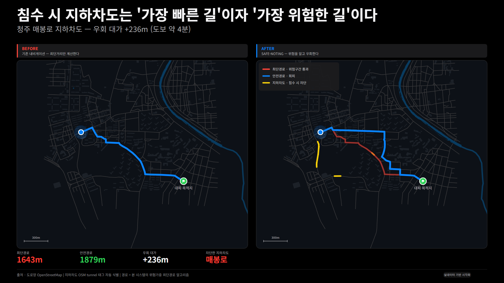
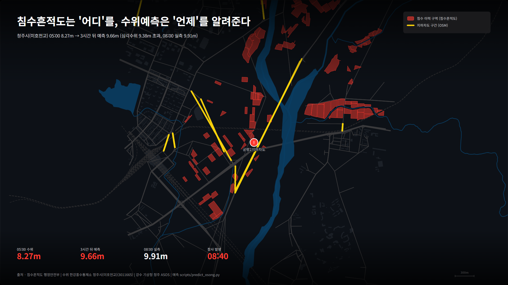

# 세이프노팅 (SAFE-NOTING)

집중호우·도시침수 상황에서 사용자의 현재 위치를 기준으로 대피 경로와 행동 안내를 생성하는 시스템의 프로토타입입니다.

- 2026 AI 도시·지역혁신 아이디어 공모전 최우수상 (주택도시보증공사 사장상)
- 단독 개발, 2026.08 – 2026.09



## 배경

긴급재난문자(CBS)는 기지국 단위로 90자 이내의 같은 문장을 보냅니다. 수신자의 위치를 모르기 때문에 "하천변·지하공간 접근 자제" 같은 일반 안내만 가능하고, 개인별 대피 경로는 줄 수 없습니다.

2023년 7월 15일 청주 궁평2지하차도 사고 당시 호우·홍수경보는 발령되어 있었습니다. 인근 미호천교 관측소 수위는 05:00에 경보수위(8.0m)를 넘었고, 사고는 08:40에 발생했습니다.

이 프로젝트는 재난문자를 대체하지 않고, 수신 이후 단계에서 사용자 위치 기준의 위험 판단과 경로를 계산합니다.

## 구성

| 단계 | 내용 | 입력 데이터 |
|---|---|---|
| 수위 예측 | 하천 수위 3시간 예측 | 한강홍수통제소 수위, 기상청 ASOS |
| 침수 위험 지도 | 침수흔적도와 수위 예측 결합 | 행정안전부 침수흔적도 |
| CCTV 침수 감지 | 하천 CCTV 프레임의 수위 경계 단계 분류 | AI Hub 부산시 침수위험 복합 데이터 |
| 위험 회피 경로 | 지하차도를 차단하고 침수흔적 근접 구간에 가중치를 둔 최단경로, 대피소 재평가 | OpenStreetMap, 행정안전부 통합대피소 |

## 결과

| 항목 | 방법 | 결과 | 문서 |
|---|---|---|---|
| 수위 예측 | DLinear 단독 모델과, DLinear에 Transformer를 게이트로 병렬 결합한 모델을 같은 조건으로 학습. 55개 관측소를 관측소 단위로 학습 39 / 검증 8 / 테스트 8 분할 | 테스트 관측소 8곳의 급상승 구간 RMSE: DLinear 0.0648 (Ridge 0.0773 대비 16% 감소), DLinear + Transformer 0.0626 (19% 감소). 아래 표 참조 | [11 §9.6](docs/11-forecast-model-design.md) |
| 사고 당일 재현 | 미호천교 관측소(학습 제외)로 2023-07-15 00–12시 3시간 예측. 같은 하천 하류 관측소의 같은 날 자료는 학습에 포함됨 | 경보수위 초과 예측 03시 (1시간 기울기 외삽과 같음). RMSE 0.653m, 기울기 외삽 0.827m 대비 21%, 현재값 유지 1.127m 대비 42% 작음 | [11 §9.7](docs/11-forecast-model-design.md) |
| 물리 기반 침수 판정 | 하천 수면고와 지반고 비교, 2017년 침수흔적 442건으로 검증 | 궁평2지하차도 반경 0.5km 이내 재현율 93.3%, 0.5–1km 80.0%, 3–5km 29.7% | [10 §2](docs/10-model-validation.md) |
| CCTV 침수 감지 | ImageNet 사전학습 ResNet18 특징 + 강우량, 카메라 단위 분할 | 학습에 없던 카메라 5대에서 ROC-AUC 0.872 (영상만 0.818). 같은 호우 사건이 학습에도 있고 검증 양성의 83%가 카메라 1대에서 나와 일반화 근거로는 제한적 | [13 §10](docs/13-cv-dataset.md) |
| 지하차도 회피 경로 | 지하차도 차단 최단경로 | 청주 매봉로: 최단 1,643m, 회피 1,879m (+236m) | 위 그림 |
| 대피소 재평가 | 시설 유형과 침수흔적 거리로 분류 | 청주 도심 지정 대피소 274곳 중 72곳(26%)이 침수 대피에 부적합 (야외 44곳, 침수흔적 200m 이내 31곳, 중복 3곳) | [rank_shelters.py](scripts/rank_shelters.py) |

수위 예측 모델 비교 (테스트 관측소 8곳, 급상승 표본 6,900건, 오차는 경보수위 대비 비율)

| 모델 | 급상승 구간 RMSE | 과소예측률 | 전체 RMSE |
|---|---|---|---|
| Ridge | 0.0773 | 93.7% | 0.0134 |
| DLinear | 0.0648 | 60.8% | 0.0367 |
| DLinear + Transformer | 0.0626 | 63.1% | 0.0296 |

급상승 구간 개선의 대부분은 DLinear와 급상승 가중 학습에서 나오고, Transformer 결합은 급상승 구간 RMSE를 3% 더 줄입니다. 과소예측률은 DLinear 단독이 더 낮습니다. 두 모델 모두 급상승 구간에 가중치를 둔 손실로 학습해, 전체 RMSE는 Ridge보다 높습니다.



침수흔적도에는 궁평2지하차도 자체의 기록이 없어, 흔적도만으로는 사고 지점이 위험 구역으로 표시되지 않습니다. 05:00 기준 모델은 3시간 뒤 9.66m(심각수위 9.38m 초과)를 예측했고, 08:00 실측은 9.91m였습니다.

## 평가 방법

데이터가 불균형하여 초기 지표가 실제 성능을 반영하지 못한 경우가 세 번 있었고, 각각 다음과 같이 평가 방식을 바꿨습니다.

1. 수위 예측: 수위는 대부분의 시간 동안 평수위에 머물러, 전체 구간 RMSE에서는 현재값 유지(persistence)가 가장 좋게 나옵니다. 급상승 구간 RMSE와 과소예측률을 따로 측정했습니다. 이 기준에서 제안 모델은 전체 RMSE가 Ridge보다 높지만 급상승 구간 오차는 더 작습니다.
2. CCTV 분할: 클립 단위로 나눴을 때 F2 0.884였으나 검증 카메라 11개가 모두 학습에도 포함되어 있었습니다. 카메라 단위로 다시 나누자 F2 0.000이 되었습니다. 학습 데이터를 추가해 경계 이상 표본을 371건에서 3,358건으로 늘렸습니다.
3. CCTV 지표: 샘플링으로 검증셋 양성 비율이 62%(실제 분포 10.1%)가 되어, 모든 프레임을 경보로 판정하는 기준선이 F2 0.891로 가장 높았습니다. 클래스 비율의 영향을 받지 않는 ROC-AUC로 바꾸고, 운영 문턱은 실제 분포 기준 헛경보 수로 환산했습니다.

침수흔적도로 침수 여부를 학습하는 LightGBM 모델은 사용하지 않았습니다. 충북 침수흔적 5,218건이 실질적으로 3개 강우사건(2017, 2020, 2006)에서 나왔고 음성 라벨이 없어 성능을 측정할 수 없었습니다. 대신 물리 기반 판정을 실측 데이터로 검증했습니다. ([10 §1](docs/10-model-validation.md))

## 데이터 수집과 전처리

| 문제 | 처리 |
|---|---|
| 홍수통제소 API가 긴 응답을 중간에 끊거나 빈 본문을 반환 | 월 단위 분할 요청, 잘린 응답 복구, 결손 시 구간을 반으로 나눠 재요청 ([collect_waterlevel.py](scripts/collect_waterlevel.py)) |
| 수위 센서 오류와 실제 홍수 구분 | 급등 후 원래 값으로 돌아오면 오류, 완만히 감소하면 홍수로 판정. 이전 규칙이 실제 홍수 315건을 제거하던 문제 수정 ([clean_waterlevel2.py](scripts/clean_waterlevel2.py)) |
| CCTV 원천 데이터 약 34GB | 압축을 풀지 않고 zip에서 필요한 프레임만 읽어 특징 추출 ([cv_extract_full.py](scripts/cv_extract_full.py)) |
| GPU 없는 환경 | 백본 미세조정 대신 사전학습 특징 + 경량 분류기 사용 |
| 호우 시 CCTV 영상 확보 | 재난문자를 감시해 해당 지역 CCTV를 자동 캡처 ([rain_watch.py](scripts/rain_watch.py)) |

## 기술 스택

Python, PyTorch, LightGBM, NetworkX, OSMnx, OpenCV, Matplotlib, SVG 렌더링(자체 구현)

## 저장소 구조

```
scripts/
  collect_*.py, rain_watch.py, cctv_dataset.py       공공 API 수집
  clean_waterlevel2.py, build_multi_dataset.py       수위 정제, 학습 데이터셋 구성
  forecast_model.py, train_multi.py, train_gbdt.py,
  ensemble.py, baseline_*.py, eval_classification.py 수위 예측 모델과 비교 실험
  predict_osong.py, osong_predictive_map.py          사고 당일 재현
  build_cv_dataset.py, split_cv_dataset.py, cv_*.py  CCTV 침수 감지
  build_road_graph.py, flood_route.py, route_*.py,
  rank_shelters.py, fetch_*.py, plot_*.py            도로망, 위험 회피 경로, 대피소 재평가
  render/                                            지도 렌더러 (장면 명세 → SVG/PNG)
  env.py                                             API 키 로더
docs/
  10-model-validation.md                             침수 판정 모델 검증
  11-forecast-model-design.md                        수위 예측 모델 설계와 실험 기록
  13-cv-dataset.md                                   CCTV 침수 감지 실험 기록
```

## 실행

```bash
pip install -r requirements.txt
cp .env.example .env    # 사용할 API 키 입력. 재난안전데이터공유플랫폼은 공인 IP 등록 필요
```

수집한 원자료, 학습된 모델 가중치, 도로망 그래프는 용량과 데이터 이용 조건 때문에 포함하지 않았습니다. 수집 스크립트로 다시 받을 수 있으며, AI Hub 데이터는 [aihub.or.kr](https://www.aihub.or.kr)에서 신청해야 합니다.

## 고지

기술 시연용 프로토타입입니다. 실제 대피 판단은 행정안전부·소방청·지자체의 공식 안내를 따라야 합니다.

지도 데이터 © OpenStreetMap contributors (ODbL)
